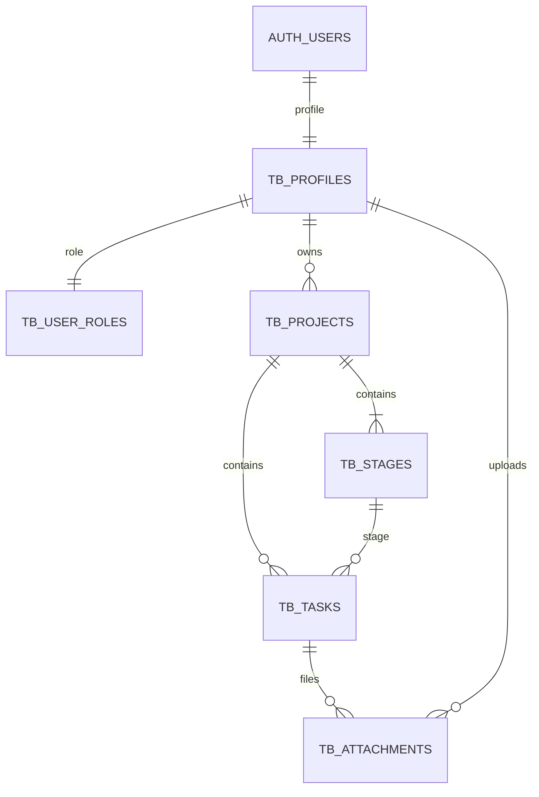

# Taskboard

Онлайн приложение: **https://svilen-taskboard.netlify.app**

Taskboard е приложение за лични проекти и задачи, разработено от Codex от нулата за курсовата работа по Software Technologies with AI. Тази реализация има собствена история на разработката и собствени SQL migrations.

## Какво прави

Интерфейсът е изцяло на английски, включително формите, съобщенията, примерните данни и началните Kanban колони. Документацията за подготовка и защита е на български.

- Начална страница, регистрация и вход.
- Обзор с изчислени статистики и предстоящи задачи.
- Създаване, редактиране, търсене и изтриване на проекти.
- Kanban табло с три колони, drag-and-drop и алтернативи за клавиатура.
- Задачи с описание, приоритет и срок; създаване, редактиране, изтриване.
- Общ списък със задачи, търсене, филтри и странициране.
- Качване, сваляне и премахване на файлове към задачите.
- Admin страница за достъпните проекти и роли на потребители.
- Изрично обозначен демонстрационен режим, който работи без облачен акаунт.

## Технологии и архитектура

HTML, CSS, JavaScript ES modules, Bootstrap 5, Vite, Supabase JavaScript SDK, SortableJS и Lucide. Без React, Vue и TypeScript.

Приложението има **10 HTML entry файла**, конфигурирани като истински Vite multi-page build. Навигацията е чрез нормални адреси (`/projects.html`, `/board.html?project=...`), с browser Back/Forward и директно отваряне на екрани. Основните екрани не са popup-и в един HTML файл.

| Папка | Предназначение |
| --- | --- |
| `src/pages` | Отделен JavaScript модул за всеки екран |
| `src/components` | Общ layout, project card и task editor |
| `src/services/backend.js` | Supabase Auth, заявки, RPC и Storage |
| `src/services/demo.js` | Самостоятелен локален demo adapter |
| `src/utils` | Валидация, статистики, подреждане и UI helpers |
| `supabase/migrations` | Версионирана SQL schema, RLS и RPC |
| `tests` | Логика и интеграционен SQL тест с PGlite |
| `docs` | Проверки, критерии и подготовка за защита |

`src/main.js` зарежда съответния page module. За частните страници първо проверява session и зарежда позволените данни. Supabase RLS, а не скриването на бутони, определя реалния достъп.

## Локално стартиране

Изисква Node.js 22.12+ или поддържана по-нова версия и npm.

```powershell
npm ci
npm run dev
```

Отвори `http://127.0.0.1:5180/` и натисни **Разгледай демото**. При зает порт Vite спира с грешка, вместо да смени адреса незабелязано.

```powershell
npm test
npm run build
npm run preview -- --port 5181
```

Пакетите са с точни версии и lockfile. `scripts/create-pages.mjs` възстановява минималните HTML shells, ако са необходими; не е нужен за нормална разработка.

## Демонстрационен режим

Демото не използва Supabase login. Бутонът от началната страница отваря локално demo пространство с примерни проекти и задачи. Избран е фиксиран demo admin. Парола не е необходима.

- Примерните записи са в namespaced localStorage и се създават само при липсващ ключ. Умишлено празните списъци не се попълват отново.
- Файловете се пазят като Blob в IndexedDB и могат да се изтеглят след refresh.
- Демо session-ът е в sessionStorage. Изходът не изтрива проектите.
- Данните са само за този браузър и origin; не се споделят между localhost и публикувания сайт.
- Cloud грешките никога не включват demo режима автоматично.

## Облачна конфигурация

Създай отделен учебен Supabase проект или избери изрично подходящ проект. Не изпълнявай migration-а в несвързана работна база.

1. Всички migrations в `supabase/migrations/`, включително `20261102112638_isolate_storage_bucket_policies.sql`, вече са приложени в студентския проект `vmorymxzdgtatjkfjspc`. Не ги пускай втори път там. За нова среда приложи файловете по ред чрез Supabase migration workflow.
2. Копирай `.env.example` в `.env` и попълни project URL и **publishable** ключ.
3. Рестартирай Vite след промяна на `.env`.
4. Регистрирай потребител. По изрично решение на студента Confirm email е изключено за курсовата: регистрацията създава session веднага и адресът не се проверява за притежание. При нова среда настрой това в Auth → Sign In / Providers. Приложението поддържа и включени confirmations.
5. Създай първия admin чрез доверен SQL достъп, използвайки действителния Auth user UUID:

```sql
-- Replace the placeholder with an actual, explicitly chosen Auth user UUID.
update public.tb_user_roles
set role = 'admin'
where user_id = '<USER_UUID>'::uuid;
```

Не задавай роля чрез signup metadata. Всеки нов потребител получава `user`, независимо какво е изпратил браузърът.

Текущата Netlify версия влиза веднага след signup, защото Confirm email е изключено. Ако по-късно се включат email confirmations, в Supabase Auth → URL Configuration задай Site URL `https://svilen-taskboard.netlify.app` и добави Redirect URL `https://svilen-taskboard.netlify.app/login.html`. За локална разработка добави `http://127.0.0.1:5180/login.html`. Приложението изпраща login адреса на текущия origin при signup.

Публични frontend променливи:

```dotenv
VITE_SUPABASE_URL=https://YOUR_PROJECT.supabase.co
VITE_SUPABASE_PUBLISHABLE_KEY=YOUR_PUBLIC_KEY
```

Никога не поставяй `service_role`, Supabase secret key или access token в `VITE_` променливи. `.env` е изключен от Git. Само URL и publishable key се включват в браузърния bundle.

За CLI връзка използвай официалния Supabase CLI, `supabase login`, `supabase link` и `supabase db push`, след като провериш текущия `--help`. Migration файлът е създаден с `supabase migration new`. След прилагане не редактирай migration-а, а добави нов.

## База данни

Има 6 собствени приложни таблици с префикс `tb_`. Префиксът отделя реализацията от предишния прототип; сам по себе си не е ограничение на достъпа.



Посетителят няма достъп до частните данни. Редовният потребител управлява своите проекти и зависимите задачи и файлове. Admin може да управлява всички проекти и да променя чужди роли. Не може да промени собствената си роля през приложението. Admin не се присъжда автоматично на първия регистриран акаунт.

Проектът се създава заедно с трите колони в една транзакция. Task mutations използват RPC и project row lock за последователно подреждане. Composite foreign keys забраняват задача да се свърже с колона от чужд проект и файл да сочи несъответстващ project/task.

## Файлове

Частният Storage bucket е `tb-attachments`. Разрешени са PNG, JPEG, WebP, PDF и plain text до 5 MB. Използват се генерирани storage paths, а оригиналното име е metadata. Storage RLS проверява действителната task/project принадлежност и текущия потребител.

При upload първо се качва файлът, след което се записва metadata. При неуспешен metadata запис се опитва compensating removal. Преди изтриване на задача или проект клиентът премахва съответните Storage objects чрез Storage API, след което изтрива DB записа. Пряко SQL изтриване извън приложението не почиства автоматично Storage; това е задача на администратора. Частични мрежови откази може да изискват повторна операция и проверка за останали обекти.

## Публикуване

Продукционната версия е публикувана в Netlify: https://svilen-taskboard.netlify.app. Проектът е `svilen-taskboard`, ID `dc3f5a3d-cf18-41cb-9be3-52af50398c04`. Student акаунтът е свързан чрез официалния Netlify CLI.

`netlify.toml` задава build `npm run build`, publish directory `dist`, Node 24 и отделни правила за деветте адреса без `.html`. Всеки адрес зарежда собствен HTML entry. Непознатите адреси връщат 404. Няма SPA catch-all.

Двете `VITE_SUPABASE_*` публични променливи са зададени и в Netlify. За следващо ръчно публикуване:

```sh
npm ci
npm test
npm run build
npx netlify-cli@27.16.1 deploy --site svilen-taskboard --dir dist --no-build --prod
```

Текущото публикуване е ръчно; Git continuous deployment още не е свързан. `.netlify/` е игнориран от Git. Старият Sites preview е запазен частен и не е адресът за предаване.

## Състояние и оставаща работа

Демонстрационният и реалният облачен поток са проверени през браузъра. 13 автоматични теста покриват логиката, migrations, достъпа и безопасното връщане след login. Migration history е синхронизирана с реалния студентски Supabase. Няма нови DB/Storage advisories; Auth има предупреждение за изключена Leaked Password Protection. Приложението използва project URL и publishable key през игнорирания `.env` файл.

Codex MCP OAuth входът е успешен. Директната MCP връзка работи. Проверени са реален вход с два app акаунта, project/task CRUD, подреждане, cloud upload/download и отказ на достъп до чужди данни. По изричен избор на студента Alex е admin, Boyan е user. Admin достъпът е проверен през Auth, Data и Storage API. Отделен файл `docs/verification.md` съдържа проверените потоци и ограниченията на проверката.

Основният код и цялата история на тази реализация са в публичния [GitHub repository](https://github.com/SvilenH/Taskboard), branch `main`. Историята започва с независимия начален commit `ebcad04`; старият прототип е премахнат от основния клон. Файлът `.github/copilot-instructions.md` съдържа инструкции за настоящата реализация и се пази, защото условието на курса изисква точно това име.

Изискваните 15 commits в 3 реални дни трябва да се натрупат през действителните следващи стъпки; не се променят дати на commits. Крайният срок е неделя, 8 ноември 2026 г., според „края на седмицата“, казано на 2 ноември.
